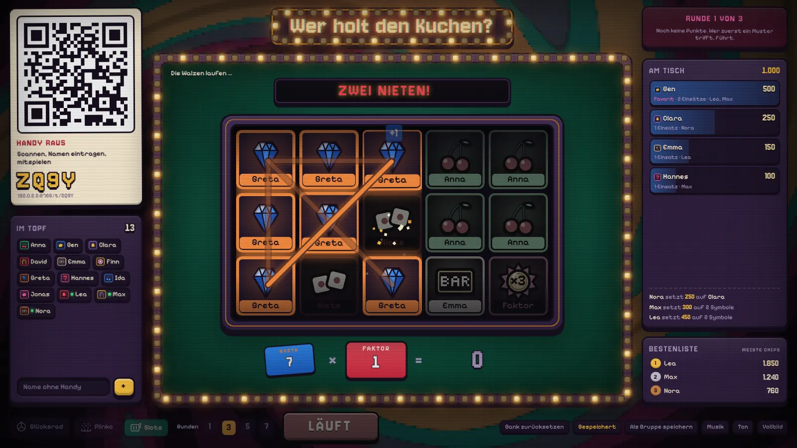
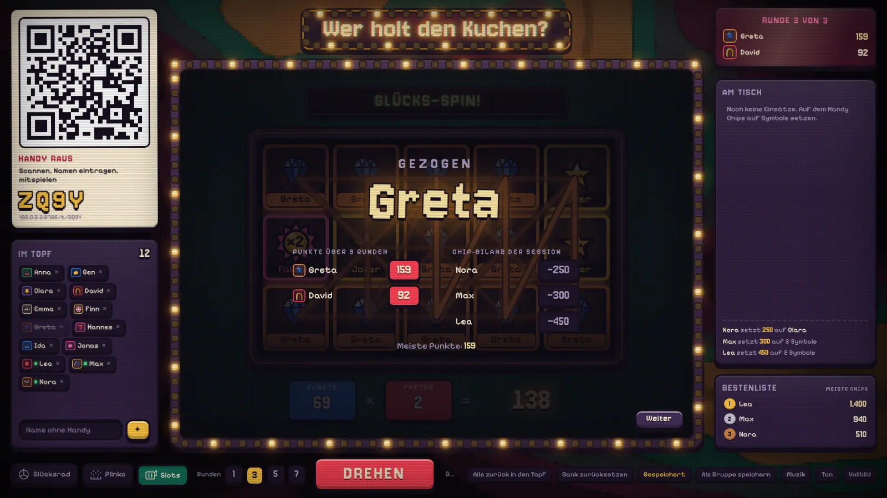
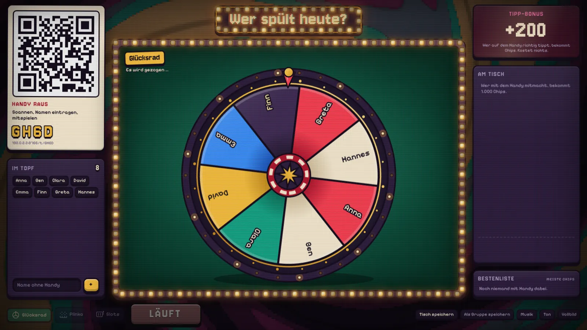
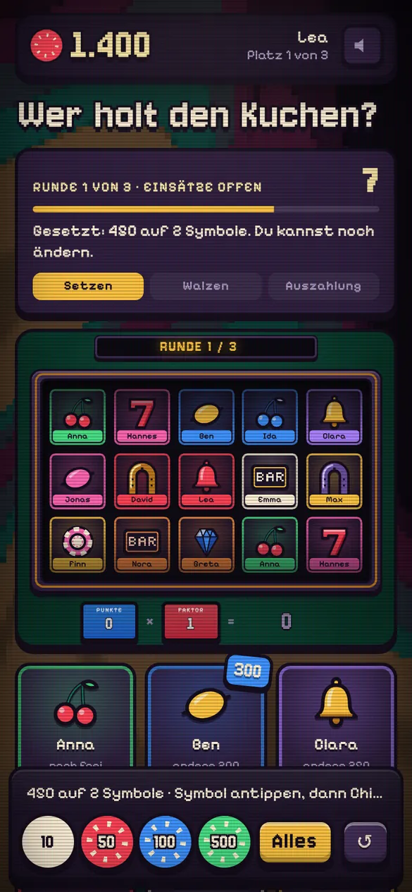
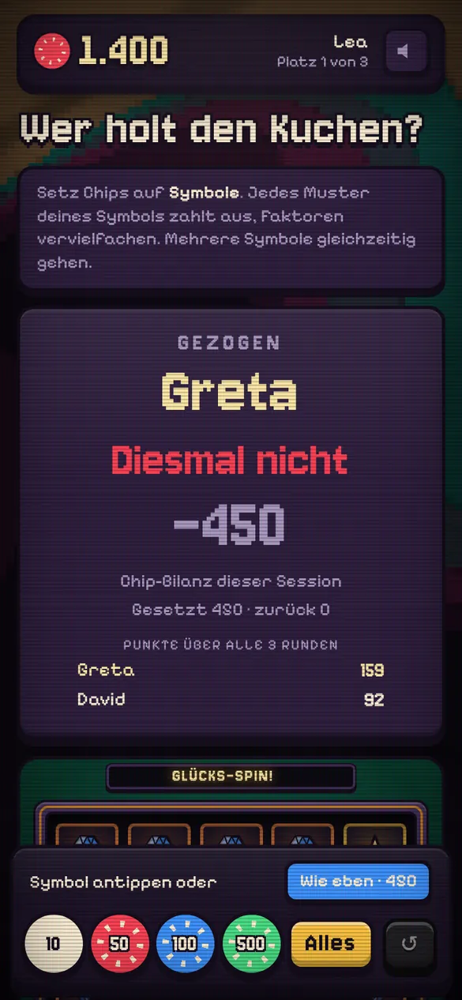

# Ramble · Auslosung

> Frühe Alpha. Dinge ändern sich, Datenbanken bleiben aber lesbar (Migrationen).

Zufallsziehung im Casino-Stil: Alle scannen den QR-Code am großen Bildschirm, tragen sich ein,
und dann wird gezogen: per **Glücksrad**, **Plinko** oder **Slots**. Python 3.10+, keine Abhängigkeiten.



<table>
  <tr>
    <td width="50%"></td>
    <td width="50%"></td>
  </tr>
  <tr>
    <td align="center"><sub>Gezogen wird, wer über alle Runden die meisten Punkte hat</sub></td>
    <td align="center"><sub>Glücksrad: kostenlos tippen, richtig getippt gibt Chips</sub></td>
  </tr>
</table>

<p align="center">
  
  &nbsp;&nbsp;
  
  <br><sub>Am Handy: Chips auf Symbole setzen, danach die eigene Bilanz</sub>
</p>

## Starten

```sh
python3 auslosung.py                   # gebündelte Einzeldatei (aus den Builds / Releases)
python3 -m auslosung                   # aus dem Quellcode
```

Optionen: `--port 8000`, `--db auslosung.db`, `--url https://…` (Adresse im QR-Code),
`--admin` (Verwaltung unter `/admin`, Schlüssel steht in der Konsole).

Auf der Startseite erscheinen nur Tische, die am großen Bildschirm gespeichert wurden.
Ungespeicherte Tische werden nach 12 Stunden ohne Aktivität gelöscht.

## Entwickeln

```sh
python3 -m unittest          # Tests
python3 tools/bundle.py      # baut dist/auslosung.py
```

`auslosung/game` ist die Spiellogik (rein bzw. mit SQLite), `auslosung/web` Vorlagen und Frontend
(ES-Module, kein Build-Schritt), `auslosung/migrations` das Schema (`NNNN_name.sql`, Nummern nie ändern).

## Lizenz

GPL-3.0, siehe [LICENSE](LICENSE). Schriften: SIL OFL 1.1. qrcode.js: MIT.
